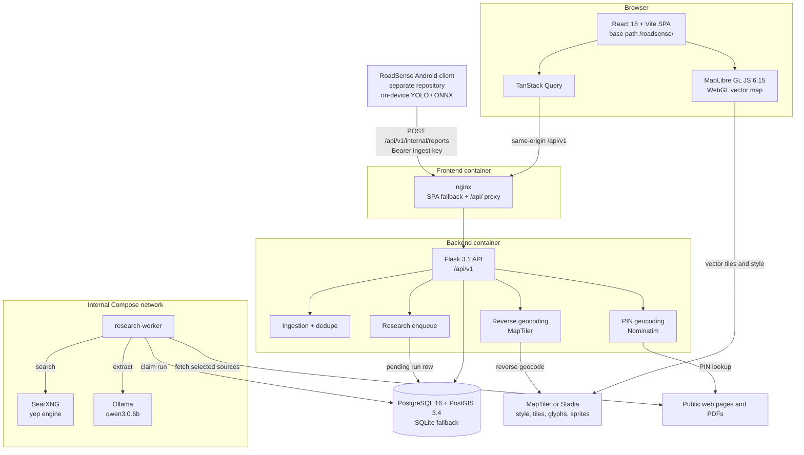

# RoadSense Web

RoadSense Web is the public web layer of the RoadSense road-condition system. It publishes
canonical pothole records detected by RoadSense monitoring vehicles, shows their cached
road/address metadata, and presents source-backed road-work research. It is a read-only public
site plus an authenticated ingestion API; it does not perform pothole inference itself.

The repository contains a React/Vite frontend, a Flask API, a PostgreSQL/PostGIS deployment
path with a SQLite development fallback, and an optional self-hosted research pipeline built on
SearXNG and Ollama.

## Features

- **Interactive pothole map** using MapLibre GL JS, an orange point layer, client-side
  clustering, cluster expansion, selected-pothole marker, zoom/recenter controls, and deep
  links for viewport and selected record.
- **Canonical-only public feed**: map markers come from `canonical_potholes`, never from
  individual vehicle reports.
- **PIN code search** through the API, plus browser geolocation to center the map.
- **Time filters** (today, last 7 days, last 30 days, all) applied client-side on the loaded map
  feed.
- **Detections ledger** with server-side search, time filters, pagination, loading/empty/error
  states, and a mobile card layout.
- **Pothole detail page** with coordinates, observation count, confidence, severity, cached
  reverse-geocoded road/locality/district/state/PIN, a MapLibre inset, related potholes, and
  source-backed work records.
- **Road-work and contractor research** with deterministic query generation, SearXNG search,
  SSRF-safe HTML/PDF fetching, Ollama JSON extraction, server-side validation, and
  `high`/`medium`/`low` confidence rules.
- **Light/dark theme** persisted in `localStorage` under `roadsense-theme`.
- **About** and **Public Data Note** pages, plus a 404 page.
- **Authenticated fleet ingestion** with idempotent report IDs and spatial/temporal
  deduplication into canonical potholes.
- **Deployment assets**: multi-stage frontend image, gunicorn backend image, nginx SPA/proxy
  configuration, and Docker Compose services for PostGIS, SearXNG, Ollama, and the research
  worker.

## Technology stack

### Frontend

| Component | Version | Role |
| --- | --- | --- |
| React / React DOM | 18.3.1 | UI |
| TypeScript | 5.7.3 | Language |
| Vite | 6.4.5 | Dev server and production build |
| React Router DOM | 6.30.6 | Client routing under `/roadsense/` |
| TanStack React Query | 5.104.5 | Server-state fetching, caching, polling |
| MapLibre GL JS | 6.15.0 | WebGL vector map rendering |
| Vitest / Testing Library / jsdom | 3.2.7 / 16.3.3 / 25.0.1 | Unit tests |
| ESLint + typescript-eslint | 9.39.5 / 8.72.0 | Linting |

Versions are the resolved versions in `frontend/package-lock.json`; `package.json` uses caret
ranges. Styling is hand-written CSS in `frontend/src/styles/global.css`; there is no CSS
framework or component library. Icons are Material Symbols loaded from Google Fonts, and the
UI fonts are Public Sans and JetBrains Mono.

### Mapping implementation

**MapLibre GL JS is the active mapping library.** There is no Leaflet or React Leaflet
dependency in `package.json`, `package-lock.json`, or the source tree.

Evidence:

- `frontend/package.json` declares `maplibre-gl: ^6.15.0`; the lockfile resolves it to
  `6.15.0`.
- `frontend/src/components/MapView.tsx:5` imports `Map as MapLibreMap` from `maplibre-gl` and
  constructs `new MapLibreMap(...)` at line 123.
- `frontend/src/components/MiniMap.tsx:4` uses the same library for the detail inset.
- `frontend/src/main.tsx:5-12` imports MapLibre, its CSS, and its worker, then calls
  `setWorkerUrl(maplibreWorkerUrl)`.
- `frontend/src/lib/mapStyle.ts` defines the MapLibre style, GeoJSON source, and circle layers.
- A source-tree search found no Leaflet imports, React Leaflet package, or Leaflet CSS.

Map behavior:

- Basemap: **vector styles**. MapTiler uses the `streets-v2-light` style by default. Stadia
  uses `alidade_smooth`. Both are fetched as MapLibre style JSON and then recolored for the
  light/dark theme by `softenBasemap()`.
- Provider choice: by default, `VITE_MAPTILER_API_KEY` selects MapTiler; otherwise Stadia.
  `VITE_MAP_PROVIDER` can force `maptiler` or `stadia`. Stadia is keyless only for localhost
  development; deployed builds need a provider key.
- Rendering: WebGL via MapLibre. The Vite build explicitly emits the MapLibre worker asset.
- Potholes are a clustered GeoJSON source (`clusterRadius: 52`, `clusterMaxZoom: 15`,
  `clusterMinPoints: 2`). Clusters are circle layers plus a count symbol; points are circle
  layers with a larger invisible hit layer. Cluster clicks use
  `getClusterExpansionZoom()`.
- Selection uses a custom DOM `Marker` plus an HTML preview card (not a MapLibre popup).
  Hover uses feature state.
- The map calls `GET /api/v1/potholes/recent?limit=2000&offset=0` as its initial feed fetch
  and filters periods client-side. React Query may poll every 5 seconds while returned
  location metadata is `pending`. The API also supports bbox queries, but the current map
  does not call them on every pan.
- Deep links use `?lat=&lng=&zoom=&pothole=`. Viewport changes are written back to the URL.
- If style loading fails or no provider key is available, the app uses a plain background
  MapLibre style and keeps the pothole layers visible, with a dismissible basemap error notice.
  The detail inset shows “Basemap unavailable” in the same situation.

### Backend

| Component | Version | Role |
| --- | --- | --- |
| Python | 3.12 in Docker; verified locally on 3.9.6 | Runtime |
| Flask | 3.1.0 | HTTP API and CLI |
| Flask-Cors | 5.0.0 | CORS for `/api/*` |
| Flask-SQLAlchemy / SQLAlchemy | 3.1.1 / 2.0.36 | ORM |
| psycopg2-binary | 2.9.10 | PostgreSQL driver |
| Gunicorn | 23.0.0 | Production WSGI server |
| requests | 2.32.3 | SearXNG, Ollama, geocoding, page fetching |
| BeautifulSoup4 | 4.12.3 | HTML text extraction |
| pypdf | 5.1.0 | PDF text extraction |
| pytest | 8.3.4 | Backend tests |
| python-dotenv | 1.0.1 | `.env` loading |

Database: **PostgreSQL 16 + PostGIS 3.4** through `postgis/postgis:16-3.4`, or **SQLite** when
`DATABASE_URL` is unset. PostGIS adds point/line geometry, geography, GiST indexes, and sync
triggers; SQLite uses ordinary latitude/longitude columns and a Python haversine fallback.
There is no Alembic/migration framework; `backend/schema.py` provides idempotent schema
initialization (`flask --app wsgi:app init-db`).

### Detection model and inference boundary

The web application does **not** run a model, host ONNX files, or process camera media. The
RoadSense Android client (a separate repository/workspace component) performs YOLO inference
on-device and sends only metadata to this backend. Per that client's model metadata, the
packaged model is `best.onnx` with input `[1, 3, 640, 640]`, output `[1, 5, 8400]`, one
`pothole` class, opset 18, CPU inference through `onnxruntime-android`, and client-side NMS.
Those model details are not implemented or verified by this repository.

The web backend receives `report_id`, `latitude`, `longitude`, `observed_at`, optional
`confidence`, and optional `gps_accuracy_m`. Camera frames, evidence images, device identifiers,
and raw sensor payloads are not part of the public or ingestion contract described here.

### Research services

| Component | Configuration | Role |
| --- | --- | --- |
| SearXNG | `searxng/searxng:latest`, `searxng/settings.yml` | Private metasearch. JSON enabled; `yep` engine enabled; other major engines disabled; limiter off. |
| Ollama | `ollama/ollama:latest` | Local model runtime. |
| Model | `qwen3:0.6b` by default | Extracts strict JSON from fetched source text only; it does not browse. |
| research-worker | `python -m services.research_worker` | Claims pending runs from the database and runs the pipeline. |

The research pipeline is optional at runtime: `RESEARCH_ENABLED=false` disables enqueueing and
public refresh. The rest of the site still works.

## Architecture



By default the browser calls the same-origin `/api/v1/*` path. Vite proxies `/api` during
development; nginx proxies `/api/` to `API_ORIGIN` in the container deployment. PostgreSQL,
SearXNG, and Ollama are not published by the supplied Compose configuration.

## Project structure

```text
RoadSense_WEB/
├── backend/
│   ├── app.py                  Flask app factory, error handlers, CLI commands
│   ├── wsgi.py                 Gunicorn/Flask entry point
│   ├── config.py               Environment-driven configuration
│   ├── db.py                   SQLAlchemy setup and SQLite pragmas
│   ├── models.py               ORM models and public-ID helpers
│   ├── schema.py               Idempotent PostGIS/SQLite schema init
│   ├── schema.sql              Reference PostgreSQL schema
│   ├── routes/
│   │   ├── public.py           Read-only public API
│   │   └── internal.py         Ingestion and admin research API
│   ├── services/
│   │   ├── spatial.py          PostGIS helpers and SQLite fallback
│   │   ├── serializers.py      Public JSON serializers
│   │   ├── geocoding.py        Nominatim PIN lookup
│   │   ├── reverse_geocoding.py MapTiler reverse geocoding
│   │   ├── location_enrichment.py Cached metadata lifecycle
│   │   ├── research_target.py  Road/location target and query context
│   │   ├── research_agent.py   Query, fetch, validate, persist pipeline
│   │   ├── search_provider.py  SearXNG client
│   │   ├── page_fetcher.py     SSRF-safe HTML/PDF fetcher
│   │   ├── ollama_client.py    Prompt construction and JSON extraction
│   │   └── research_worker.py  DB-backed worker
│   ├── tests/                  pytest suite and synthetic fixtures
│   ├── Dockerfile
│   ├── entrypoint.sh
│   └── requirements.txt
├── frontend/
│   ├── src/
│   │   ├── main.tsx            React root, MapLibre worker, router
│   │   ├── App.tsx             Routes
│   │   ├── components/         Map, mini map, search, header/footer, cards
│   │   ├── pages/              Map, ledger, detail, about, data note, 404
│   │   ├── lib/                API client, types, map style/data, formatting
│   │   ├── hooks/              React Query and UI hooks
│   │   ├── theme/              Light/dark theme provider
│   │   └── styles/global.css   Design tokens and responsive CSS
│   ├── public/
│   ├── nginx.conf              SPA and `/api/` reverse proxy template
│   ├── Dockerfile              Node build + nginx runtime
│   ├── package.json
│   ├── package-lock.json
│   ├── vite.config.ts          Base path `/roadsense/`, dev proxy
│   ├── vitest.config.ts
│   └── tsconfig*.json
├── searxng/settings.yml
├── docker-compose.yml
├── .env.example                Compose and deployment variables
├── Design files/               Supplied visual references
└── IMPLEMENTATION_REPORT.md    Historical phase report
```

`frontend/dist`, `frontend/node_modules`, `backend/.venv`, `backend/instance`, and caches are
generated or local-only and are ignored by Git.

## How it works

### 1. Observation ingestion

`POST /api/v1/internal/reports` is the only ingestion route. It requires
`Authorization: Bearer <INGEST_API_KEY>`; if `INGEST_API_KEY` is unset, ingestion returns
`503`. A valid request returns `201` when it creates a canonical pothole and `200` when it
merges into an existing one or replays a duplicate `report_id`.

The payload fields are:

```json
{
  "report_id": "device-42-2026-10-21T09-32-11Z",
  "latitude": 8.893214,
  "longitude": 76.614102,
  "observed_at": "2026-10-21T09:32:11+05:30",
  "confidence": 0.94,
  "gps_accuracy_m": 4.2
}
```

`report_id`, `latitude`, and `longitude` are required. `observed_at` defaults to now; values
more than 10 minutes in the future are rejected. `confidence` must be between 0 and 1.
`report_id` is unique, so retries are idempotent and return `duplicate_report: true`.

### 2. Canonical pothole handling

If no canonical record is within `DEDUPE_RADIUS_M` (default 25 m) whose
`last_detected_at` falls inside `DEDUPE_WINDOW_DAYS` (default 45), a new
`CanonicalPothole` is created. Otherwise the existing record is updated:

- `report_count` increments;
- `first_detected_at` takes the earlier timestamp;
- `last_detected_at` takes the later timestamp;
- the highest confidence is retained, with severity derived as `severe` at ≥0.85,
  `moderate` at ≥0.70, otherwise `low`.

Each accepted observation is stored in `detection_reports`. Those rows are internal; public
serializers expose only canonical summaries, counts, timestamps, coordinates, and linked
metadata.

Road linkage uses `match_road()`: PostGIS line geometry when available, otherwise road
latitude/longitude, within `ROAD_MATCH_RADIUS_M` (default 30 m). There is no name-based or
proximity-only contractor inference.

### 3. Reverse-geocoded metadata

New canonical potholes get a `pothole_location_metadata` row with status `pending`. When
`REVERSE_GEOCODING_ASYNC=true`, a daemon thread enriches it after ingestion; otherwise the
`enrich-locations` CLI does it. MapTiler reverse geocoding is server-side only and requires
`MAPTILER_API_KEY`.

The canonical coordinate is never rewritten. Provider fields are cached and may remain null;
missing road number, classification, or authority is not guessed. Public reads use only cached
metadata and never call the provider. Statuses are `pending`, `resolved`, `failed`, and
`skipped`, with bounded retries and `next_retry_at` backoff.

### 4. Public map and ledger reads

- The map requests up to 2,000 recent canonical potholes (server-capped by
  `PUBLIC_MAX_LIMIT`) and filters by time in the browser. It does not issue a bbox request per
  pan; it may poll while cached location metadata is pending.
- The ledger uses `GET /api/v1/potholes/recent` with server-side `q`, `since`/`since_days`,
  `limit`, and `offset`. Search covers road name/number/locality/PIN/authority plus cached
  reverse-geocoded road/locality/district/state/PIN and public pothole ID.
- Detail uses `GET /api/v1/potholes/<PH-ID>`. It returns the canonical summary, road detail,
  cached location metadata, linked project, latest research run, and up to four related
  potholes on the same road.
- `GET /api/v1/potholes` provides bbox-scoped canonical reads for other clients, and
  `GET /api/v1/potholes/nearby` provides radius reads.

### 5. Road-work research pipeline

Research is road-level, not pothole-inference-based. The flow is:

1. `build_target()` requires a road name from cached location metadata or the linked road. If
   neither exists, research cannot be started.
2. `generate_queries()` builds up to `RESEARCH_MAX_QUERIES` deterministic queries from the
   road name and its generic base alias, locality, district, state, PIN, municipality, and
   authority. Official-domain queries use Kerala domains when the state is Kerala, otherwise
   `gov.in`/`nic.in`.
3. `SearXNGProvider` calls the private SearXNG `/search` JSON endpoint, requesting
   `SEARCH_ENGINE_URL` with `SEARXNG_ENGINES` (default `yep`), `SEARXNG_RESULTS_PER_QUERY`
   (default 5), and a timeout.
4. Results are URL-normalized and deduplicated. Domains are tiered: official government
   (tier 1), academic/research (tier 2), known media and tender aggregators (tier 3), and
   general websites (tier 4). Only tiers 1–3 are fetched.
5. Up to `RESEARCH_MAX_FETCHES` pages are fetched with SSRF protections. HTML is reduced to
   title and text with BeautifulSoup; PDFs are read with pypdf (first 20 pages). Fetch and
   extraction limits are configurable.
6. Fetched text is checked deterministically for the target road, a strong location signal,
   and work/tender terms. Up to three relevant sources are selected for extraction.
7. Ollama receives only the target context and truncated source excerpts. It is asked for one
   strict JSON object using an Ollama JSON schema; temperature is 0.
8. `validate_model_result()` ignores the model's own confidence. It requires a supplied source,
   an exact supporting quote, the target road plus location context, a work term, and a
   source tier below 4. A contractor name is reported only if it appears in the evidence. It
   then computes confidence deterministically.

### 6. Evidence and confidence

| Result | Meaning |
| --- | --- |
| `high` | A cited government/official source explicitly links the target road to the contractor and a work record. |
| `medium` | A cited official, media, or tender-aggregator source lists a related work/tender record, including records without a contractor. Confirm the original record. |
| `low` / `none` | No contractor is displayed. `low` is normalized to `none` by the public serializer. |
| `failed` | Search, fetch, Ollama, or time-budget failure. The UI says research is temporarily unavailable. |
| `none` with a completed run | No source-backed road work record was found. |

`high` means “cited official-source match”, not an independent audit or ground truth. Tender
aggregators can only produce `medium`. General websites are rejected. Missing authority,
tender number, or work reference values are removed unless they appear in the cited source.

Sources are stored in `pothole_research_sources` with URL, domain, tier, query, rank, fetch
status, selected flag, text length, and `retrieved_at`. Runs are stored in
`pothole_research_runs` separately from canonical potholes.

### 7. Caching, async work, and failure handling

- A research key is built from road, locality, district, state, and PIN. Completed runs are
  reused for `RESEARCH_CACHE_DAYS`; failed runs are not retried before
  `RESEARCH_FAILED_RETRY_SECONDS`.
- Pending/running runs are reused rather than duplicated.
- The worker claims pending rows; PostgreSQL uses `FOR UPDATE SKIP LOCKED`. Stale `running`
  rows are marked `failed` with `worker_timeout`.
- Public detail requests enqueue research automatically when a road target exists.
- The public “Research again” action is rate-limited by
  `RESEARCH_REFRESH_COOLDOWN_SECONDS` and returns `429` with `Retry-After` during cooldown,
  `409` when road metadata is unresolved, and `503` when research is disabled or unavailable.
- Search failures, unreachable sources, blocked pages, invalid JSON, and time-budget
  exhaustion become failed runs or no-match results; they are not converted into guessed data.
- CAPTCHAs, paywalls, and provider blocks are not bypassed.

## Prerequisites

Required for the web application:

- Python 3.9+ (the Docker image uses Python 3.12; this audit ran the tests on Python 3.9.6).
- Node.js and npm (the Docker build uses `node:22-alpine`; this audit ran on Node 26.12.0).
- SQLite for local development, or PostgreSQL 16 + PostGIS 3.4 for the production path.
- Docker and Docker Compose if using the supplied container stack.

Optional or external:

- **MapTiler** browser key and/or **Stadia Maps** key for a deployed vector basemap. Stadia
  works keyless on localhost only.
- **MapTiler** server key for reverse geocoding.
- Outbound access to **Nominatim** for PIN code search.
- **SearXNG** and **Ollama** for research. Without them the rest of the site still runs, but
  research fails or is disabled.

No external database, Redis, or Celery service is required; the research queue is in the
database.

## Local development setup

### Backend with SQLite

```bash
cd backend
python3 -m venv .venv
source .venv/bin/activate
pip install -r requirements.txt
flask --app wsgi:app run --debug --port 5001
```

With no `DATABASE_URL`, the app uses `backend/instance/roadsense.db`, creates tables on boot
(`AUTO_INIT_DB=true`), and keeps foreign keys and WAL enabled. Verify:

```bash
curl http://127.0.0.1:5001/api/v1/health
curl http://127.0.0.1:5001/api/v1/meta
```

For the CLI and tests, the same virtual environment can be used:

```bash
backend/.venv/bin/pytest -q
```

### Frontend

```bash
cd frontend
npm ci
cp .env.example .env.local
npm run dev
```

`frontend/.env.example` defaults to the same-origin API path:

```env
VITE_API_BASE_URL=/api/v1
VITE_API_PROXY_TARGET=http://127.0.0.1:5001
```

Open <http://localhost:5173/roadsense/>. Vite serves the app under `/roadsense/` and proxies
`/api` to `VITE_API_PROXY_TARGET`, so the browser does not call Flask cross-origin. If
`VITE_API_BASE_URL` is relative and `VITE_API_PROXY_TARGET` is missing, Vite fails at startup
with a configuration error.

To read a deployed API from local development, set `VITE_API_PROXY_TARGET` to the deployment
root **without** `/api` or `/api/v1`, for example
`https://<your-deployment-host>/roadsense`. Keep `VITE_API_BASE_URL=/api/v1`.

### Database initialization and optional backfill

SQLite creates its schema automatically on boot. For PostgreSQL, either run the Compose
entrypoint once with `RUN_DB_INIT=true`, or run:

```bash
cd backend
flask --app wsgi:app init-db
```

Backfill reverse-geocoded metadata for existing canonical potholes:

```bash
flask --app wsgi:app enrich-locations --limit 100
flask --app wsgi:app enrich-locations --pothole PH-000003
flask --app wsgi:app enrich-locations --retry-failed
flask --app wsgi:app enrich-locations --force
```

This never changes canonical coordinates.

### Docker Compose deployment

```bash
cp .env.example .env
# Set at minimum: POSTGRES_PASSWORD, INGEST_API_KEY, SEARXNG_SECRET,
# RESEARCH_ADMIN_KEY. Set MAPTILER_API_KEY for server-side reverse geocoding
# and VITE_MAPTILER_API_KEY or VITE_STADIA_API_KEY for the deployed basemap.
docker compose up --build
```

For local access, set `WEB_BIND_ADDRESS=127.0.0.1` (or `0.0.0.0` for local-only testing)
and open <http://localhost:8091/roadsense/>. The example `.env` uses deployment-specific bind
addresses; set `API_BIND_ADDRESS` and `WEB_BIND_ADDRESS` to an interface you intend to expose.

Services and ports:

| Service | Container port | Host exposure | Purpose |
| --- | --- | --- | --- |
| `db` | 5432 | internal only | PostGIS database |
| `backend` | 5000 | `API_BIND_ADDRESS:API_PORT` | Flask/gunicorn API |
| `frontend` | 80 | `WEB_BIND_ADDRESS:WEB_PORT` | nginx SPA and `/api/` proxy |
| `searxng` | 8080 | internal only | private search |
| `ollama` | 11434 | internal only | local extraction model |
| `ollama-init` | none | none | one-time model pull |
| `research-worker` | none | none | async research worker |

The backend entrypoint runs `flask --app wsgi:app init-db` when `RUN_DB_INIT=true`, then starts
gunicorn. For production, set `RUN_DB_INIT=false` and run `init-db` as a single deploy step
instead of racing multiple replicas.

## Environment variables

### Backend and Compose

| Variable | Required | Default / example | Purpose |
| --- | --- | --- | --- |
| `DATABASE_URL` | No | `sqlite:///<repo>/backend/instance/roadsense.db` | PostgreSQL URL in production; SQLite fallback locally. |
| `SECRET_KEY` | No | development placeholder | Flask secret; no account/session system currently uses it. |
| `AUTO_INIT_DB` | No | `true` | Create schema at app startup. Set `false` in production. |
| `RUN_DB_INIT` | No | `false` | Compose entrypoint runs `init-db` when `true`. |
| `INGEST_API_KEY` | Yes for ingestion | empty | Bearer key for `POST /internal/reports`; empty disables ingestion with `503`. |
| `CORS_ORIGINS` | No | local Vite/Compose origins plus one deployment-specific origin | Comma-separated exact browser origins. Add your deployed site origin. |
| `DEDUPE_RADIUS_M` | No | `25` | Canonical merge radius. |
| `DEDUPE_WINDOW_DAYS` | No | `45` | Canonical merge window. |
| `ROAD_MATCH_RADIUS_M` | No | `30` | Road-segment match tolerance. |
| `GEOCODING_PROVIDER_URL` | No | Nominatim search URL | PIN geocoding endpoint. |
| `GEOCODING_USER_AGENT` | Recommended | deployment contact string | Nominatim User-Agent; set a real contact address. |
| `GEOCODING_TIMEOUT_SECONDS` | No | `8` | PIN geocoding timeout. |
| `GEOCODING_CACHE_SECONDS` | No | `86400` | In-memory PIN cache TTL. |
| `MAPTILER_API_KEY` | For reverse geocoding | empty | Server-side MapTiler key; never exposed by the API. |
| `MAPTILER_GEOCODING_URL` | No | MapTiler geocoding API | Reverse-geocoding base URL. |
| `MAPTILER_REFERER` | If key is origin-restricted | empty | Exact allowed site origin. |
| `REVERSE_GEOCODING_ENABLED` | No | `true` | Disable provider calls while retaining cached data. |
| `REVERSE_GEOCODING_ASYNC` | No | `true` | Enrich new potholes in a background thread. |
| `REVERSE_GEOCODING_LANGUAGE` | No | `en` | Provider language. |
| `REVERSE_GEOCODING_TIMEOUT_SECONDS` | No | `8` | Provider timeout. |
| `REVERSE_GEOCODING_MIN_INTERVAL_SECONDS` | No | `0.25` | Throttle between provider calls. |
| `REVERSE_GEOCODING_MAX_ATTEMPTS` | No | `6` | Maximum attempts before marking failed. |
| `REVERSE_GEOCODING_RETRY_BASE_SECONDS` | No | `900` | Exponential backoff base. |
| `REVERSE_GEOCODING_RETRY_MAX_SECONDS` | No | `86400` | Backoff cap. |
| `REVERSE_GEOCODING_NO_RESULT_RETRY_SECONDS` | No | `604800` | Retry interval after no match. |
| `REVERSE_GEOCODING_BATCH_LIMIT` | No | `100` | CLI batch default. |
| `PUBLIC_DEFAULT_LIMIT` | No | `500` | Default public read limit. |
| `PUBLIC_MAX_LIMIT` | No | `2000` | Hard public read cap. |
| `PUBLIC_DETAIL_LIMIT` | No | `25` | Related-pothole limit on road detail. |
| `RESEARCH_ENABLED` | No | `true` | Enable research enqueue/refresh/worker. |
| `RESEARCH_ADMIN_KEY` | For admin routes | empty | Bearer key for internal research routes; falls back to `INGEST_API_KEY` in code if unset. |
| `SEARCH_ENGINE_URL` | No | `http://searxng:8080` | SearXNG base URL. `SEARXNG_URL` is a compatibility alias. |
| `SEARXNG_ENGINES` | No | `yep` | Comma-separated engine list. |
| `SEARXNG_TIMEOUT_SECONDS` | No | `15` | Search request timeout. |
| `SEARXNG_RESULTS_PER_QUERY` | No | `5` | Results retained per query. |
| `OLLAMA_URL` | No | `http://ollama:11434` | Ollama base URL. |
| `RESEARCH_MODEL` | No | `qwen3:0.6b` | Extraction model. |
| `RESEARCH_OLLAMA_TIMEOUT_SECONDS` | No | `120` | Ollama request timeout. |
| `RESEARCH_OLLAMA_NUM_CTX` | No | `4096` | Ollama context size. |
| `RESEARCH_OLLAMA_NUM_PREDICT` | No | `512` | Ollama output token limit. |
| `RESEARCH_MAX_QUERIES` | No | `12` | Queries per run. |
| `RESEARCH_MAX_FETCHES` | No | `5` | Pages fetched per run. |
| `RESEARCH_MAX_SOURCE_CHARS` | No | `3000` | Per-source prompt budget. |
| `RESEARCH_MAX_CONTEXT_CHARS` | No | `9000` | Total prompt source budget. |
| `RESEARCH_MAX_HTML_BYTES` | No | `3000000` | HTML download cap. |
| `RESEARCH_MAX_PDF_BYTES` | No | `8000000` | PDF download cap. |
| `RESEARCH_MAX_DURATION_SECONDS` | No | `180` | Wall-clock budget per run. |
| `RESEARCH_SEARCH_DELAY_SECONDS` | No | `0.8` | Delay between searches. |
| `RESEARCH_FETCH_DELAY_SECONDS` | No | `1.2` | Delay between fetches. |
| `RESEARCH_CACHE_DAYS` | No | `30` | Completed-result reuse window. |
| `RESEARCH_FAILED_RETRY_SECONDS` | No | `3600` | Failed-run retry delay. |
| `RESEARCH_REFRESH_COOLDOWN_SECONDS` | No | `600` | Public manual-refresh cooldown. |
| `RESEARCH_WORKER_POLL_SECONDS` | No | `5` | Worker idle poll interval. |
| `RESEARCH_USER_AGENT` | Recommended | `RoadSenseResearch/1.0 ...` | User-Agent for search, fetch, and research calls. |
| `RESEARCH_ALLOWED_PORTS` | No | `80,443` | Ports allowed by the SSRF-safe fetcher. |
| `POSTGRES_PASSWORD` | Yes (Compose) | placeholder | PostGIS password. |
| `SEARXNG_SECRET` | Yes (Compose) | placeholder | SearXNG secret. |
| `API_BIND_ADDRESS` / `API_PORT` | No | deployment-specific / `5001` | Host binding for the API. |
| `WEB_BIND_ADDRESS` / `WEB_PORT` | No | deployment-specific / `8091` | Host binding for nginx. |
| `API_ORIGIN` | No | `http://backend:5000` | Upstream root used by nginx for `/api/`; do not append `/api`. |

### Frontend

| Variable | Required | Default / example | Purpose |
| --- | --- | --- | --- |
| `VITE_API_BASE_URL` | No | `/api/v1` | Complete browser-facing API base. Keep same-origin by default. |
| `VITE_API_PROXY_TARGET` | Yes for dev with relative base | `http://127.0.0.1:5001` | Vite proxy target, without `/api`. |
| `VITE_MAP_PROVIDER` | No | empty (`maptiler` or `stadia`) | Override provider selection. |
| `VITE_MAPTILER_API_KEY` | For MapTiler | empty | Public browser key. |
| `VITE_MAPTILER_STYLE_URL` | No | `https://api.maptiler.com/maps/streets-v2-light/style.json` | MapTiler style. |
| `VITE_STADIA_API_KEY` | For deployed Stadia | empty | Public browser key. |
| `VITE_STADIA_STYLE_URL` | No | `https://tiles.stadiamaps.com/styles/alidade_smooth.json` | Stadia style. |
| `VITE_MAP_DEFAULT_LAT` | No | `8.8932` | Initial map latitude. |
| `VITE_MAP_DEFAULT_LNG` | No | `76.6141` | Initial map longitude. |
| `VITE_MAP_DEFAULT_ZOOM` | No | `14` | Initial zoom. |

Browser map keys are necessarily present in the built bundle. Restrict them to the deployed
origin in the provider dashboard; do not use a server-only MapTiler key for the browser.

## API overview

All routes are under the Flask blueprint prefix `/api/v1`.

| Method | Path | Auth | Purpose |
| --- | --- | --- | --- |
| `GET` | `/health` | none | Database-backed liveness check. |
| `GET` | `/meta` | none | Canonical pothole count and latest observation time. |
| `GET` | `/potholes?bbox=min_lng,min_lat,max_lng,max_lat` | none | Canonical potholes in a bbox. Also accepts `min_lat`/`max_lat`/`min_lng`/`max_lng`. |
| `GET` | `/potholes/recent` | none | Paginated ledger; `q`, `since`, `since_days`, `status`, `limit`, `offset`. |
| `GET` | `/potholes/nearby` | none | Radius query; `lat`, `lng`, `radius_km` (0.05–50), `limit` (max 500). |
| `GET` | `/potholes/<PH-ID>` | none | Canonical detail, road, project, latest research, related records. Also accepts numeric IDs. |
| `POST` | `/potholes/<PH-ID>/research` | none, cooldown | Enqueue a public research refresh; returns `202`, `409`, `429`, or `503`. |
| `GET` | `/roads/<int:road_id>` | none | Road detail, linked project, recent potholes. |
| `GET` | `/geocode?pincode=691001` | none | Server-side PIN lookup. |
| `GET` | `/geocode/pincode/<pincode>` | none | Path variant of PIN lookup. |
| `POST` | `/internal/reports` | Bearer `INGEST_API_KEY` | Fleet observation ingestion and deduplication. |
| `POST` | `/internal/potholes/<PH-ID>/research` | Bearer `RESEARCH_ADMIN_KEY` or `INGEST_API_KEY` | Enqueue research, optionally `{"force": true}`. |
| `GET` | `/internal/potholes/<PH-ID>/research` | Bearer `RESEARCH_ADMIN_KEY` or `INGEST_API_KEY` | Inspect the latest run, queries, sources, timings, and error code. |

Validation notes:

- Bounding boxes use `min_lng,min_lat,max_lng,max_lat`; minimums must be less than maximums
  and the area is capped at 400 square degrees.
- Public `/potholes` and `/potholes/recent` limits are capped by `PUBLIC_MAX_LIMIT` (default
  2,000); `/potholes/nearby` is capped at 500.
- PIN codes must be six digits and cannot start with `0`.
- Public routes are read-only; unsupported methods return `405`.
- CORS is applied to `/api/*` with the origins in `CORS_ORIGINS`.
- Responses use `{"error": {"message": "...", "status": n}}` on errors.

## Testing and verification

Commands supported by the repository:

```bash
# Backend
cd backend
.venv/bin/pytest -q

# Frontend
cd frontend
npm test
npm run typecheck
npm run lint
npm run build
```

Results from this audit (static inspection plus local execution):

| Check | Result |
| --- | --- |
| Backend `pytest -q` | **47 passed**, 1 warning (urllib3/OpenSSL warning in the local venv) |
| Frontend `npm test` | **19 passed** across 4 test files |
| Frontend `npm run typecheck` | Passed |
| Frontend `npm run lint` | Passed |
| Frontend `npm run build` | Passed; Vite emitted the MapLibre worker and warned about a large main chunk |
| Map/SearXNG/Ollama/PostGIS integration | **Not exercised in this audit** |
| Docker Compose stack | **Not built or started in this audit** |

The test suite uses synthetic SQLite fixtures. It covers bbox/nearby queries, pagination and
search, detail/road endpoints, PIN validation and caching, reverse-geocoding parsing and
lifecycle, ingestion authentication and deduplication, contractor provenance rules, research
query generation, road matching, SSRF validation, source selection, prompt sanitization,
result validation, cooldown behavior, and failure mapping. It does not prove external
provider or production deployment health.

To verify locally:

1. Start the backend and check `/api/v1/health` and `/api/v1/meta`.
2. Start Vite and load `/roadsense/`; confirm the basemap notice is absent and canonical
   records appear.
3. Open a detail page and confirm the inset, cached metadata state, and research panel.
4. If research is enabled, check SearXNG `/healthz` and Ollama’s model list before expecting
   research to complete.

## Deployment

The supplied deployment is a Docker Compose stack:

- `frontend` builds with Node 22, runs `npm run build`, and serves the static output with
  nginx 1.27. The Vite `base` is `/roadsense/`; nginx rewrites `/roadsense/*` to the document
  root and falls back to `index.html` for SPA routes. Asset files are cached for one year.
- nginx proxies `/api/` to `${API_ORIGIN}/api/` using `proxy_pass`, with SNI enabled for HTTPS
  upstreams. `API_ORIGIN` must be a root URL without `/api`.
- `backend` runs gunicorn with 3 workers, 4 threads, and a 60-second timeout on port 5000.
  The entrypoint optionally initializes the schema once.
- `db` is PostGIS 16/3.4 with a named volume and `pg_isready` health check.
- `searxng`, `ollama`, and `research-worker` communicate only on the internal Compose network.
  `ollama-init` pulls `RESEARCH_MODEL` once.
- Persistent volumes: `roadsense_pgdata`, `roadsense_ollama`, `roadsense_searxng_cache`.

Repository-supported deployment steps are the Compose commands above. TLS termination,
firewall rules, external DNS, VPN/reverse-proxy ingress, off-host backups, and edge rate
limiting are **not defined by this repository**; treat them as external infrastructure
requirements. The checked-in Compose file is not proof of the current production topology.

For a schema change:

```bash
docker compose run --rm backend flask --app wsgi:app init-db
```

Back up the PostGIS volume first. The project has no versioned migration runner, so review
`schema.py` changes carefully.

## Limitations and troubleshooting

- **SQLite is for development and tests**, not production scale. PostGIS is the intended
  production path.
- **No user accounts.** Public reads are unauthenticated; only ingestion and internal research
  inspection/enqueueing use bearer keys. The public research refresh endpoint has no
  authentication; it is throttled by a cooldown and validates the target.
- **Research is best-effort.** Coverage depends on SearXNG’s index and which public pages are
  reachable. Tender aggregators may be the only source for some works and remain `medium`.
  Official portals requiring CAPTCHA are not bypassed.
- **`high` is not independent verification.** It means a cited official/government source
  explicitly connects the road and contractor. Read the source before relying on it.
- **Small local model.** `qwen3:0.6b` can return invalid JSON on weak context; that becomes a
  failed run, not guessed data.
- **Reverse geocoding needs MapTiler.** Without `MAPTILER_API_KEY`, metadata stays pending or
  failed; the map still renders canonical coordinates.
- **PIN search needs Nominatim.** Timeouts, 429s, 5xx responses, and missing results are
  surfaced as API errors to the UI.
- **Deployed basemap needs a browser key.** Stadia’s keyless mode is localhost-only. With no
  key or a failed style fetch, pothole layers still render over a plain background and a
  notice appears.
- **Map data failure** shows a loading/error banner with retry; the rest of the page remains
  usable.
- **Research dependency failure** normally shows “Road research temporarily unavailable.” A
  completed search with no acceptable evidence shows “No source-backed road work record
  found.” A matched record without a contractor shows “Not recorded in the cited source.”
- **No automatic repair-status updates.** Status is stored data only.
- **No versioned migrations.** `init-db` is idempotent but not a migration history.
- **Large frontend bundle.** The current MapLibre-based build is about 1.35 MB minified
  (about 378 KB gzip) in one main chunk; route-level splitting is not implemented.
- **Local and deployed databases can differ.** Point `VITE_API_PROXY_TARGET` and
  `API_ORIGIN` at the intended backend; otherwise a local site can look empty while production
  has records.
- **Android is a separate client.** This repository does not validate on-device model
  accuracy, GPS behavior, or offline queue behavior.

## Security and privacy

- Keep `.env` files and real credentials out of Git. `.gitignore` ignores `.env` and
  `.env.*` except `.env.example`.
- Set long random values for `INGEST_API_KEY`, `RESEARCH_ADMIN_KEY`, `SEARXNG_SECRET`, and
  `POSTGRES_PASSWORD`. Use a secret manager or deployment-specific environment injection.
- `MAPTILER_API_KEY` is server-side only. `VITE_MAPTILER_API_KEY` and
  `VITE_STADIA_API_KEY` are public browser keys by nature; restrict them by origin and rotate
  them if abused.
- Do not publish PostgreSQL. The supplied Compose file exposes only `5432` internally.
- Public serializers omit `detection_reports`, internal numeric pothole IDs (public `PH-...`
  IDs are used), camera media, device identifiers, and raw sensor payloads. Public responses
  include canonical coordinates, observation counts, timestamps, linked road IDs/metadata,
  and project provenance.
- The page fetcher validates schemes, rejects credentials in URLs, blocks internal hostnames
  and suffixes, restricts ports (`RESEARCH_ALLOWED_PORTS`, default 80/443), resolves and
  rejects non-global IPs, revalidates redirects, respects robots.txt, caps redirects, bytes,
  and fetch time.
- Search/fetch user agents should identify the deployment with a real contact address.
- CORS is restricted to exact configured origins. nginx adds `X-Content-Type-Options`,
  `Referrer-Policy`, and `X-Frame-Options`; the API adds the same and `Cache-Control: no-store`
  for `/api/`.
- Do not bypass CAPTCHAs, paywalls, or provider blocks.

## Project status and contributing

RoadSense Web is a working public prototype: the local test suites pass, the map and API are
implemented, and the Compose/deployment assets are present. It is not presented here as
production-hardened. Production use requires external TLS, access control review, rate
limiting, backups, and provider configuration.

No license file is present in this repository; do not assume permission to reuse or
redistribute the code until a license is added. Contributions should keep the canonical-only,
provenance-first rules intact and should not add inferred contractor or road data.
